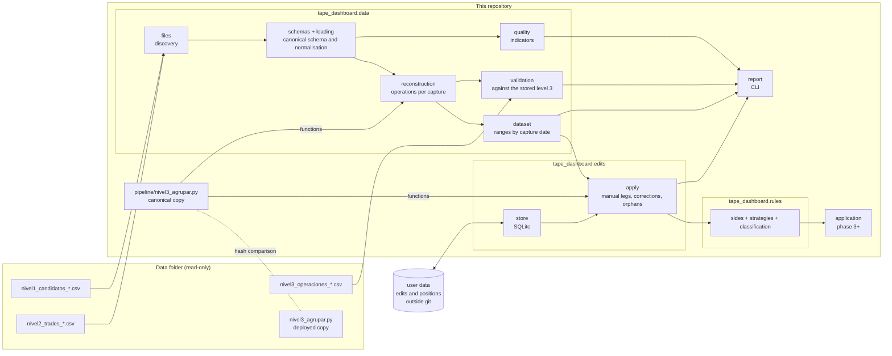

# Architecture

## Layers

**Pipeline** ([`pipeline/nivel3_agrupar.py`](../pipeline/nivel3_agrupar.py)). A standalone script, standard library only, that the capture pipeline runs to produce level 3. It is the only implementation of the grouping: the dashboard imports its functions ([decision 0002](decisiones/0002-una-sola-logica-de-agrupacion.md)). Its output is protected by the regression test.

**Data layer** (`tape_dashboard.data`). Reads the data folder without modifying it and produces the operations:

1. `files` groups the files by capture date and reports any CSV it does not recognise. It also compares the script copy in the data folder with the canonical one.
2. `schemas` defines each level's canonical schema and the known variants; `loading` renames columns, normalises values and reports files that do not fit ([data contract](data-contract.md)).
3. `reconstruction` runs level 2 through the script's functions (`preparar_filas` → `agrupar` → `resumen`, `patas_de`, `id_operacion`, `pasa_umbral`) and keeps every operation, above the threshold or not.
4. `dataset` gathers the captures and answers the interface's queries: operations in a range of capture dates without repeated IDs, and which capture is "today".
5. `validation` compares each reconstruction with the stored level 3; `quality` computes the [data quality](data-quality.md) indicators.

Anything that does not fit becomes an `Issue` attached to its file: errors (the file or the day is not used), warnings and informational notes. Nothing is dropped silently.

**Rules** (`tape_dashboard.rules`). Pure functions, no input or output: each leg's side (`sides`), the catalogue of two-leg operation types (`strategies`) and the classification of each operation into a single destination (`classification`). See the [business rules](business-rules.md#5-classifying-operations).

**Edits** (`tape_dashboard.edits`). `store` keeps corrections and manual legs in a SQLite file in the user-data folder. `apply` applies them on a snapshot, in the order the specification asks for: rebuild every operation, add the manual legs (recomputing with the script), classify with the corrections and, last, filter by threshold. It also detects orphan edits, which are never deleted. It provides the queries for tabs 1 and 2.

**Interface** (phase 3 onwards). The three tabs on top of the `Dataset` and the rules.

## Data layer design choices

- **Plain Python structures** (dataclasses and dictionaries), no pandas: the volume is small (about 40,000 trades) and this keeps the layer independent of the interface. If the charts need it, the data will be converted in phase 4.
- **Every capture is loaded** at start-up; it takes a few seconds.
- **The values the script uses are not touched**: the reconstruction is byte-for-byte identical to the pipeline's (the tests check it on every real capture).
