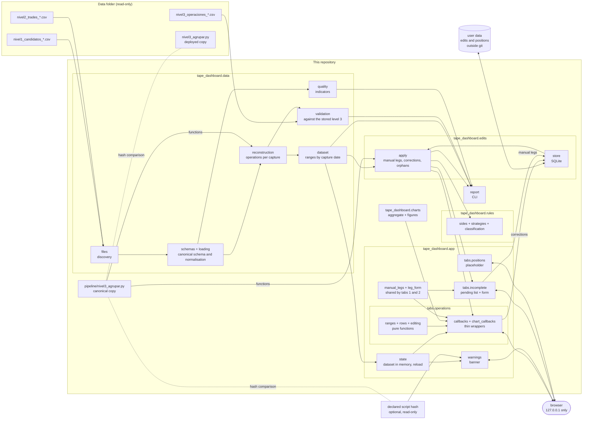

# Architecture

## Layers

**Pipeline** ([`pipeline/nivel3_agrupar.py`](../pipeline/nivel3_agrupar.py)). A standalone script, standard library only, that the capture pipeline runs to produce level 3. It is the only implementation of the grouping: the dashboard imports its functions ([decision 0002](decisions/0002-single-grouping-logic.md)). Its output is protected by the regression test.

**Data layer** (`tape_dashboard.data`). Reads the data folder without modifying it and produces the operations:

1. `files` groups the files by capture date and reports any CSV it does not recognise. It also compares the script copy in the data folder with the canonical one.
2. `schemas` defines each level's canonical schema and the known variants; `loading` renames columns, normalises values and reports files that do not fit ([data contract](data-contract.md)).
3. `reconstruction` runs level 2 through the script's functions (`preparar_filas` → `agrupar` → `resumen`, `patas_de`, `id_operacion`, `pasa_umbral`) and keeps every operation, above the threshold or not.
4. `dataset` gathers the captures and answers the interface's queries: operations in a range of capture dates without repeated IDs, and which capture is "today".
5. `validation` compares each reconstruction with the stored level 3; `quality` computes the [data quality](data-quality.md) indicators.

Anything that does not fit becomes an `Issue` attached to its file: errors (the file or the day is not used), warnings and informational notes. Nothing is dropped silently.

**Rules** (`tape_dashboard.rules`). Pure functions, no input or output: each leg's side (`sides`), the catalogue of two-leg operation types (`strategies`) and the classification of each operation into a single destination (`classification`). See the [business rules](business-rules.md#5-classifying-operations).

**Edits** (`tape_dashboard.edits`). `store` keeps corrections and manual legs in a SQLite file in the user-data folder. `apply` applies them on a snapshot, in the order the specification asks for: rebuild every operation, add the manual legs (recomputing with the script), classify with the corrections and, last, filter by threshold. It also detects orphan edits, which are never deleted. It provides the queries for tabs 1 and 2.

**Charts** (`tape_dashboard.charts`). `aggregate` turns classified operations into what the charts show: net bars by expiration or strike, the separate totals and the walls by strike, with the ITM flag ([business rules](business-rules.md#6-charts)). It is pure Python, without Dash or Plotly. `figures` builds the Plotly figures from that. The reference price comes from `Dataset.price_on_or_before`.

**Application** (`tape_dashboard.app`). A Dash app, started with `python -m tape_dashboard`, that only listens on 127.0.0.1 ([decision 0023](decisions/0023-ui-stack.md)):

- `state.AppState` holds what every callback shares: the `Dataset`, loaded once at start-up and re-read by the Reload button, and the edits store, read again on every request so that a saved correction shows at once.
- `warnings` gathers the notices of the banner: a missing data folder, the deployed script compared with the canonical one, the declared hash ([decision 0026](decisions/0026-declared-script-hash-check.md)), every `Issue` that is not informational, and orphan edits.
- `layout` builds the page: header, banner and one tab per package in `tabs/`. Each tab exposes `TITLE`, `layout(state)` and `register(app, state)`.
- In `tabs/operations`, the logic the interface adds is in pure functions: `ranges` (which capture dates a preset covers), `rows` (grid rows and columns), `editing` (which correction an operation accepts, and saving it). `view` builds the components; `callbacks` connects the list and the pop-up, and `chart_callbacks` the charts. Each callback calls a controller that takes the state and plain values (`grid_content`, `detail_content`, `modal_action`, `net_chart`, `walls_chart`…), so the tests call the controllers without a browser.
- Two counters in `dcc.Store` (`data-version`, `edits-version`) tell the callbacks when to refresh: Reload increments the first, saving a correction the second. Grid rows carry a stable ID (`getRowId`), so a refresh updates them in place instead of rebuilding the grid.
- `manual_legs` holds the logic of the manual leg that completes a pending operation: reading the form, building the completed operation with the script, the operation types that fit, the preview and saving, which validates everything before writing. `leg_form` builds its fields with an ID prefix, so tab 2's form and tab 1's pop-up share them ([decision 0030](decisions/0030-manual-legs.md)).
- `tabs/incomplete` is tab 2: a day selector, the pending operations of that capture and the form. Saving increments `edits-version`, so the operation leaves the list and appears in tab 1.
- The editing pop-up is plain Dash with local CSS: no component library or external stylesheet ([decision 0027](decisions/0027-editing-pop-up-without-extra-dependencies.md)).

## Data layer design choices

- **Plain Python structures** (dataclasses and dictionaries), no pandas: the volume is small (about 40,000 trades) and this keeps the layer independent of the interface. If the charts need it, the data will be converted in phase 4.
- **Every capture is loaded** at start-up; it takes a few seconds.
- **The values the script uses are not touched**: the reconstruction is byte-for-byte identical to the pipeline's (the tests check it on every real capture).
