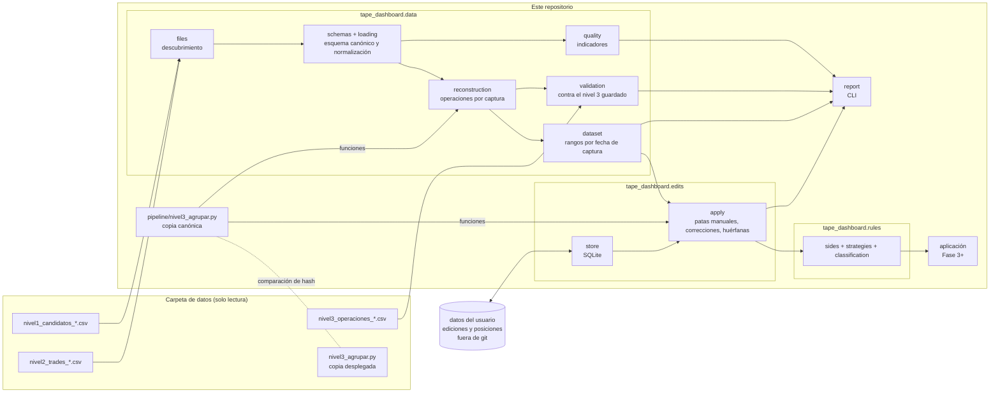

# Arquitectura

## Capas

**Pipeline** ([`pipeline/nivel3_agrupar.py`](../pipeline/nivel3_agrupar.py)). Script autónomo, solo con la biblioteca estándar, que el pipeline de captura ejecuta para generar el nivel 3. Es la única implementación de la agrupación: el dashboard importa sus funciones ([decisión 0002](decisiones/0002-una-sola-logica-de-agrupacion.md)). Su salida está protegida por el test de no regresión.

**Capa de datos** (`tape_dashboard.data`). Lee la carpeta de datos sin modificarla y produce las operaciones:

1. `files` agrupa los ficheros por fecha de captura y reporta los CSV que no reconoce. También compara la copia del script de la carpeta de datos con la canónica.
2. `schemas` define el esquema canónico de cada nivel y las variantes conocidas; `loading` renombra las columnas, normaliza los valores y reporta los ficheros que no encajan ([contrato de datos](contrato-datos.md)).
3. `reconstruction` pasa el nivel 2 por las funciones del script (`preparar_filas` → `agrupar` → `resumen`, `patas_de`, `id_operacion`, `pasa_umbral`) y conserva todas las operaciones, pasen o no el umbral.
4. `dataset` reúne las capturas y responde a las consultas de la interfaz: operaciones de un rango de fechas de captura sin repetir IDs, y qué captura corresponde a «hoy».
5. `validation` compara cada reconstrucción con el nivel 3 guardado; `quality` calcula los indicadores de [calidad de datos](calidad-datos.md).

Todo lo que no encaja se convierte en un aviso (`Issue`) con su fichero: errores (el fichero o el día no se usan), avisos e informativos. Nada se descarta en silencio.

**Reglas** (`tape_dashboard.rules`). Funciones puras, sin entrada ni salida: el lado de cada pata (`sides`), el catálogo de tipos de operación de dos patas (`strategies`) y la clasificación de cada operación en un único destino (`classification`). Ver [reglas de negocio](reglas-negocio.md#5-clasificación-de-operaciones).

**Ediciones** (`tape_dashboard.edits`). `store` guarda las correcciones y las patas manuales en un SQLite de la carpeta de datos del usuario. `apply` las aplica sobre una instantánea, en el orden que pide la especificación: reconstruir todas las operaciones, añadir las patas manuales (recalculando con el script), clasificar con las correcciones y, al final, filtrar por umbral. También detecta las ediciones huérfanas, que nunca se borran. Ofrece las consultas de las pestañas 1 y 2.

**Interfaz** (Fase 3 en adelante). Las tres pestañas sobre el `Dataset` y las reglas.

## Decisiones de diseño de la capa de datos

- **Estructuras simples de Python** (dataclasses y diccionarios), sin pandas: el volumen es pequeño (unos 40.000 trades) y así la capa no depende de la interfaz. Si los gráficos lo necesitan, se convertirá en la Fase 4.
- **Se cargan todas las capturas** al arrancar; tarda unos segundos.
- **Los valores que consume el script no se tocan**: la reconstrucción es idéntica byte a byte a la del pipeline (lo comprueban los tests con cada captura real).
